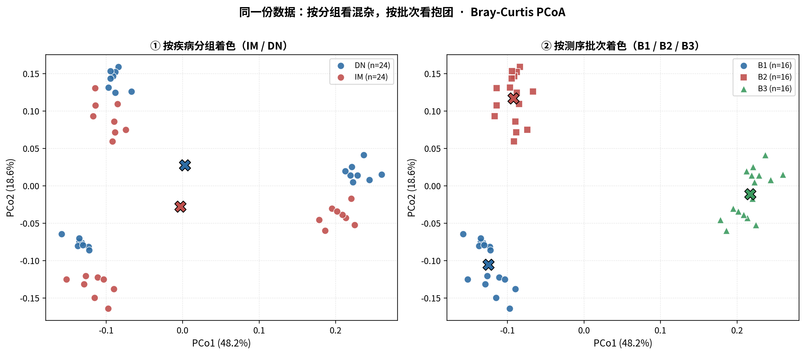
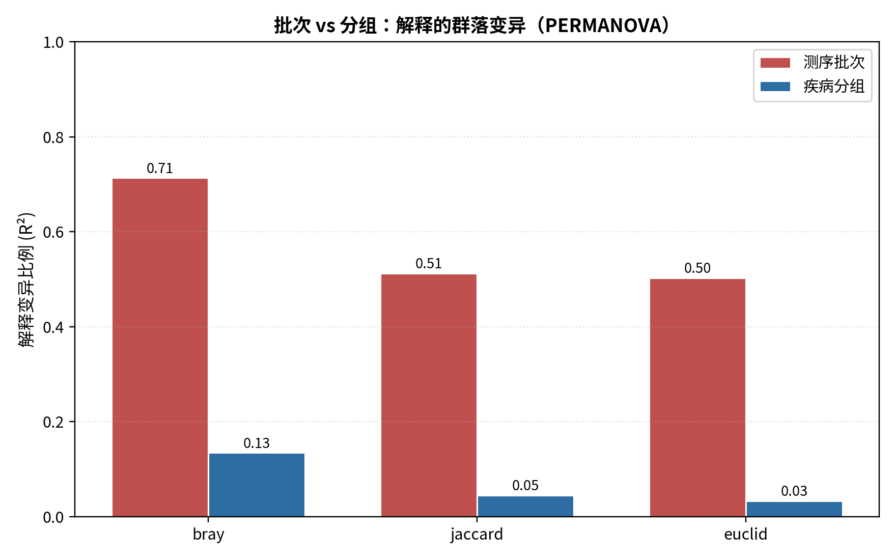
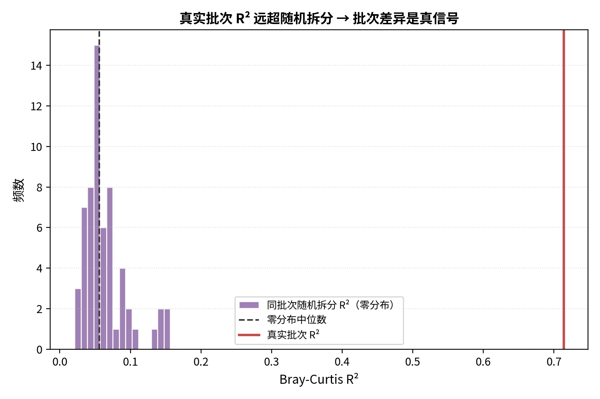
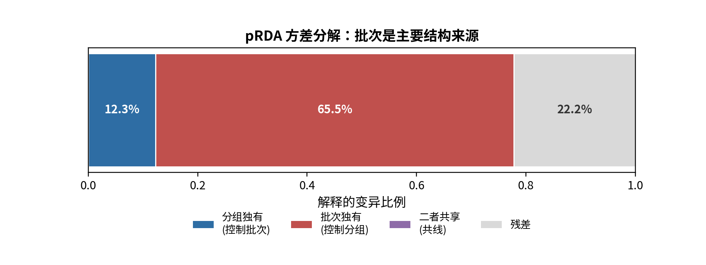

# 批次效应分析示例：PCoA → PERMANOVA → pRDA/PVCA

> 本文是公众号推文《批次效应》的配套实战代码。

一套**自包含、可直接运行**的微生物组批次效应分析示例脚本。脚本内置模拟数据，无需真实数据或 `skbio` 即可复现完整分析流程与配图。

核心逻辑沿一条主流路径展开：

> **PCoA 可视化（看现象） → PERMANOVA 定量（给数字） → pRDA/PVCA 分解（拆干净）**

模拟数据被刻意构造成「分组信号弱、批次信号强」，用来演示一个常见陷阱：*看起来像疾病差异的信号，其实主要来自测序批次*。

---

## 示例结果

三步产出四张图，讲的是同一个故事：

**① PCoA：按分组着色混杂，按批次着色抱团**



**② PERMANOVA：批次解释的变异远超分组；阴性对照证实是真信号**





**③ pRDA 方差分解：控制批次后，疾病独有信号所剩无几**



关键数值（Bray-Curtis 距离）：

| 分析 | 批次 | 分组 |
|---|---|---|
| PERMANOVA R² | 0.714 (P=0.002) | 0.134 (P=0.002) |
| pRDA 控制对方后的偏效应 | 0.655 (P=0.002) | 0.123 (P=0.002) |

阴性对照（同批次随机拆两组）的 R² 中位数仅为 0.056，远低于真实批次 R²。

---

## 目录结构

```
batch_effect_demo/
├── README.md                          # 本文件
├── demo_common.py                     # 公共模块：模拟数据 + 统计函数
├── step1_pcoa.py                      # ① PCoA 可视化
├── step2_permanova.py                 # ② PERMANOVA 定量 + 阴性对照
├── step3_prda.py                      # ③ pRDA/PVCA 方差分解
├── run_all.py                         # 一键运行三步
└── output/                            # 运行产物（配图 + 结果表）
    ├── step1_pcoa_by_group_and_batch.png
    ├── step2_permanova_bar.png
    ├── step2_null_control.png
    ├── step2_permanova_result.csv
    ├── step3_prda_partition.png
    └── step3_prda_result.csv
```

---

## 快速开始

### 依赖

仅需 Python 3.8+ 与四个科学计算库：

```bash
pip install numpy pandas scipy matplotlib
```

无需 `skbio`、无需外部数据文件，全部算法用 NumPy 实现。

### 运行

```bash
# 一键跑完三步，生成全部图与表
python run_all.py

# 或单独运行某一步
python step1_pcoa.py
python step2_permanova.py
python step3_prda.py
```

产物统一输出到 `output/` 目录。

---

## 换成你自己的数据

`demo_common.py` 中的所有统计函数是通用的（输入是「菌种 × 样本」计数表 + 样本元数据）。把它接到真实数据只需两步：

1. 准备计数表 `counts`（DataFrame，行=菌种/ASV，列=样本）与元数据 `meta`（DataFrame，行=样本，含 `group`、`batch` 两列）；
2. 在各 step 脚本中把
   ```python
   counts, meta = make_demo_data()
   ```
   替换为你自己的读取逻辑，例如：
   ```python
   counts = pd.read_csv("your_asv_table.csv", index_col=0)
   meta   = pd.read_csv("your_metadata.csv", index_col=0)
   ```

其余距离计算、置换检验、作图代码无需改动。若要做稀释，可在读入后按最小测序深度自行重抽样。

---

## 算法口径

本项目复刻自批次效应验证中使用的 `sens_gates.py`，保持口径一致：

- **距离**：Bray-Curtis 基于相对丰度；Jaccard 基于检出/未检出（reads ≥ 10）；欧氏基于 log10(相对丰度 + 1e-6)
- **PERMANOVA**：距离平方分解的伪 F 与 R²，置换检验 P = (1 + 不小于观测值的置换数) / (1 + 置换次数)
- **PCoA**：距离矩阵双中心化后特征值分解，仅保留正特征值，解释率按正特征值和归一化
- **pRDA**：哑变量设计矩阵（截距 + k−1），R² 用 QR 分解计算 `trace(Yc′HYc)/trace(Yc′Yc)`，偏效应经分层置换检验

所有随机过程均固定随机种子，结果可复现。

---

## 联系作者

如有任何问题，或在使用代码时遇到了 Bug，欢迎提交 Issue，或在公众号后台留言联系我。

## 许可

仅供学习与交流使用。
